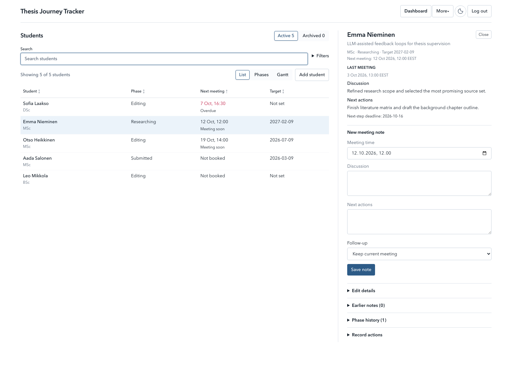
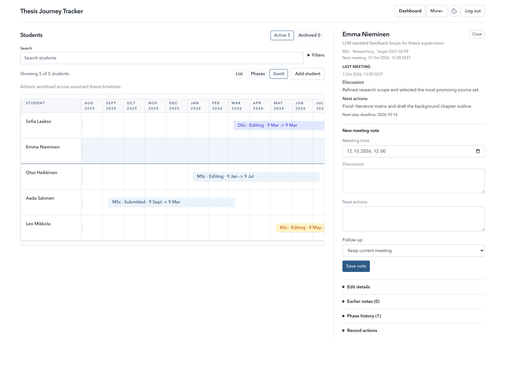
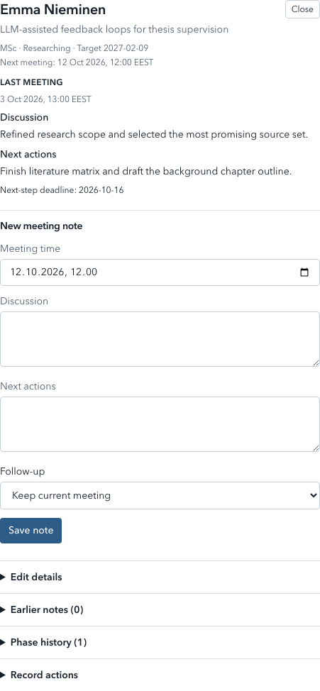

# Thesis Journey Tracker

Thesis Journey Tracker is a private advising dashboard for following students as they move through a thesis process. Supervisors manage their theses and attach advisors. Each advisor sees only assigned students and their supervision history. Administrators manage accounts and rights.

The project is intentionally small and server-rendered, with a focused workflow for thesis advising instead of a generic student information system.

## Screenshots

<table>
  <tr>
    <td width="50%">
      
    </td>
    <td width="50%">
      
    </td>
  </tr>
  <tr>
    <td>
      <strong>Dashboard overview</strong><br />
      Switch between list, phase, and Gantt views, scan upcoming supervision work, and keep the selected student workspace open while browsing the cohort.
    </td>
    <td>
      <strong>Gantt workload view</strong><br />
      Estimate advisor workload visually from thesis start dates and degree-based duration assumptions while keeping the selected student details in reach.
    </td>
  </tr>
  <tr>
    <td colspan="2" align="center">
      
    </td>
  </tr>
  <tr>
    <td colspan="2" align="center">
      <strong>Student workspace</strong><br />
      Read the last meeting and record the next one immediately. Edit details, earlier notes, phase history, and record actions expand when needed.
    </td>
  </tr>
</table>

## Why This Project Exists

- Keep thesis supervision work organized without relying on spreadsheets or scattered notes.
- See where students are in the process at a glance.
- Record meeting outcomes and next steps in a format that is easy to revisit later.

## What You Can Do With It

- As a supervisor, add students with degree type, thesis topic, and timeline information. Assign or remove existing advisors from each thesis in **Manage access**.
- As an administrator, create accounts, change rights, reset passwords, and disable or permanently remove accounts in **Manage access**. Transfer a departing supervisor’s theses first.
- Change your own sign-in name under **More → My account**. Your password, thesis assignments, and agent tokens follow your account.
- Track each student through thesis phases from planning to submission.
- Configure the dashboard lane labels at the app level while keeping the original four-phase board structure as the default.
- Switch between `List`, `Phases`, and `Gantt` views depending on whether you need detail, workflow stage, or workload shape.
- Open a student directly into their last meeting and a new-note form. The list stays alongside on desktop; phones show a focused student view with a return action.
- Save discussion notes and next actions together. Meeting time defaults to the student's booked meeting, or the current time when no meeting is booked. Meeting-time fields use half-hour increments. Follow-up defaults to the same local time one week after the note's meeting time, or continues the student's repeating schedule; choose `Not booked` to clear it or `Set new meeting` to book another time.
- Keep unsaved note and detail drafts when switching or closing students. Drafts stay in memory for the current page; leaving or reloading prompts before discarding them.
- Follow upcoming meetings from the dashboard, and clear a cancelled meeting until a new time is booked.
- Set internal weekly or multiweek meeting schedules that keep the agreed local time across clock changes and advance when a meeting note is saved.
- Connect Codex through **Agent access** to read or update students, notes, and schedules using MCP. Professor accounts have readonly tools; each account creates and revokes its own tokens in the UI. See [the agent setup guide](./docs/agent-access.md).
- Search students and filter by degree, phase, meeting status, or unfinished MSc theses past their target. Meetings within the next 72 hours are marked as soon; later meetings are scheduled.
- Use the Gantt view to estimate advisor workload visually from student start dates and degree-based thesis duration assumptions.
- Archive a student to keep their supervision history. To remove a duplicate, open its record under **Archived → Record actions**, choose **Permanently delete student**, and confirm the record ID. Only the lead supervisor can delete the record. Deletion removes its meeting notes, phase history, and thesis assignments. Choose **Restore to active students** to resume supervision.
- Administrators can export and restore full student JSON backups. Supervisors can download a Markdown report covering their assigned cohort.
- Store automated Cloudflare backups in R2 when deployed with the scheduled backup setup.

## Quick Start

1. Install dependencies and generate Worker types:

```bash
npm ci
npm run types:generate
```

2. Create your local environment file:

```bash
cp .dev.vars.example .dev.vars
```

Set `SESSION_SECRET` and `APP_ENCRYPTION_SECRET` to different random values of at least 32 bytes before starting the app.

3. Apply migrations and create your first account:

```bash
npm run db:migrate
npm run account:create -- --name "Advisor" --role editor
```

On a new installation, grant your account administrator and supervisor rights using the [first-administrator setup](./docs/setup.md#5-create-the-first-administrator). Then run `npm run doctor:local`. When upgrading a legacy team of one editor and one read-only account, both keep access to every existing thesis. The editor becomes the administrator and lead supervisor. [Access migration](./docs/deployment.md#upgrading-an-existing-cohort)

The create command requires an available username and prompts privately for a password of at least 15 characters. To reset a password, verify the account ID and run `npm run account:reset-password -- --id VERIFIED_ID`. [Account setup and recovery](./docs/setup.md#5-create-the-first-administrator)

Optional: load sample data for a ready-made local dashboard:

```bash
npm run db:seed:sample
```

4. Start the app:

```bash
npm run dev
```

Wrangler will print the local URL, typically `http://127.0.0.1:8787`.
Local development uses the same password verification as deployed environments.
If a local page returns `500`, run `npm run doctor:local` and check the `npm run dev` terminal output. Localhost responses include the thrown error message to make setup problems easier to diagnose.

For the full setup flow, remote account management, and troubleshooting, see [docs/setup.md](./docs/setup.md).

## Docker Backup Path

If local Node or Windows shell setup gets in the way, you can run the app through Docker instead:

```bash
docker build -t thesis-journey-tracker .
docker volume create thesis-journey-tracker-state
```

Then follow the container setup commands in [docs/setup.md](./docs/setup.md#docker-backup-setup). The container uses the same Wrangler local D1 workflow, with database state stored in the named Docker volume.

## Documentation

- [docs/setup.md](./docs/setup.md): local setup, environment variables, and first run
- [docs/agent-access.md](./docs/agent-access.md): Codex MCP setup, readonly access, and internal repeating meetings
- [docs/development.md](./docs/development.md): scripts, testing, local CI, and day-to-day engineering workflows
- [docs/template-updates.md](./docs/template-updates.md): applied `vibe-template` maintenance updates and sync scope
- [docs/deployment.md](./docs/deployment.md): production deployment, security, and release notes
- [docs/project-structure.md](./docs/project-structure.md): architecture, directory map, and codebase orientation
- [docs/backups.md](./docs/backups.md): automated R2 backups and restore flow
- [docs/performance-plan.md](./docs/performance-plan.md): Lighthouse baseline and performance follow-up
- [docs/ux-review.md](./docs/ux-review.md): utilitarian UX review focused on recording meeting notes
- [docs/passkey-auth-plan.md](./docs/passkey-auth-plan.md): deferred passkey assessment and rollout plan
- [docs/roadmap.md](./docs/roadmap.md): future feature ideas and next steps
- [AGENTS.md](./AGENTS.md): durable repo-specific rules for automated contributors

If you want to understand how the codebase is organized before diving in, start with [docs/project-structure.md](./docs/project-structure.md).
